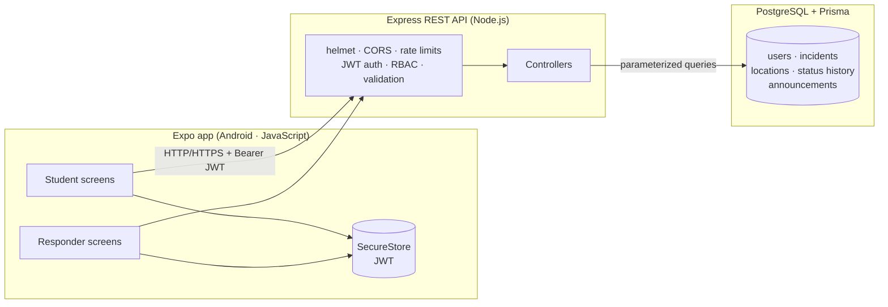

# 🛡️ SecureByte

**Campus emergency alerts & incident reporting** — Hacktoberfest Hack Day Dhanbad 2026, Track 2 (Campus Emergency & Safety).

> ⚠️ **Honest scope disclaimer:** SecureByte is a hackathon **prototype**. It is **not** connected to police, ambulance, fire services, or any real emergency infrastructure. "Responders" are demo accounts on this project's own server. All claims in this README are backed by code and tests in this repository — features that don't exist yet are listed under *Planned*.

---

## What it does

**Students** register/sign in, trigger a **3-second-cancellable Emergency SOS** (GPS attached when permitted, campus-landmark fallback when denied, haptic feedback, one-tap SMS to their saved emergency contacts), file categorized incident reports **with photo evidence**, check in **SAFE / NEEDS HELP** during campus events, browse a **campus safety map** (exits, AEDs, first aid, shelters, security offices — sorted by real GPS distance), and track every report through a live status timeline: **New → Acknowledged → In Progress → Resolved**. Everything lands in an **in-app notification center** with per-category mute preferences.

**Responders** sign into the same app and get a searchable queue sorted **SOS-first**, acknowledge → work → resolve incidents with audit-trailed notes, view **real-time analytics** (7-day trend, resolution times, category breakdown), post campus safety announcements, and monitor student check-ins. **Admins** additionally get a campus user directory.

**The app follows the OS light/dark setting** with a full dual-palette design system, skeleton loaders, press-scale micro-interactions, toasts, confirmation dialogs on every critical action, haptic feedback and reduced-motion support.

**The backend** enforces everything server-side: JWT auth + rotating refresh tokens, DB-verified roles (STUDENT / RESPONDER / ADMIN), account lockout, field/coordinate validation, rate limiting, duplicate-SOS protection, transactional status updates with audit history, photo uploads with MIME/size validation, and a notification pipeline that writes in-app records even when push is unavailable — all in PostgreSQL.

### Verified MVP workflow (all 8 steps executed & passing)

1. ✅ Student signs in → 2. ✅ submits simulated SOS → 3. ✅ backend validates + stores it in PostgreSQL → 4. ✅ responder retrieves it (other device/session) → 5. ✅ acknowledges + updates status → 6. ✅ change recorded in `incident_status_history` → 7. ✅ student sees the updated status + responder note → 8. ✅ unauthorized users are blocked (401/403 — verified).

---

## Architecture



Full diagrams (ERD + SOS sequence) and the security model: [docs/ARCHITECTURE.md](docs/ARCHITECTURE.md).

## Repository structure

```
securebyte/
├── mobile/      Expo app — Expo Router, JavaScript, adaptive light/dark theme
│   ├── app/            login · register · home · sos · report (+photo) · my-reports ·
│   │                   incident/[id] (+photo viewer) · dashboard (queue/analytics/users) ·
│   │                   announcements · profile (prefs) · map · contacts · notifications
│   ├── assets/         app icon · adaptive icon · splash · favicon
│   └── src/            api client (silent refresh + multipart upload) · AuthContext ·
│                       components (toast, confirm dialog, skeletons…) · hooks · theme · utils
├── backend/     Express + Prisma + PostgreSQL
│   ├── prisma/         schema.prisma · migrations/ · seed.js (demo data + safety points)
│   ├── src/            config · middleware (auth/validation/ratelimit/errors/upload)
│   │                   · controllers · routes · lib/push · lib/notify
│   ├── uploads/        photo evidence (created at runtime, git-ignored)
│   └── tests/          80 Jest + Supertest tests (6 suites)
├── docs/        SETUP · API · TESTING · ARCHITECTURE · screenshots/
├── postman/     CampusShield.postman_collection.json (auto-saves tokens)
├── README.md
└── .gitignore   (secrets excluded — only .env.example is committed)
```

## Quick start

Detailed beginner walkthrough: **[docs/SETUP.md](docs/SETUP.md)** (prerequisites, database creation, every env var explained, troubleshooting table).

```bash
# ── Backend (terminal 1) ──────────────────────────────
cd backend
npm install
cp .env.example .env            # then edit: DATABASE_URL, JWT_SECRET (≥32 chars)
# create DBs once (docs/SETUP.md §3):
#   CREATE ROLE campusshield LOGIN PASSWORD 'campusshield_dev' CREATEDB;
#   CREATE DATABASE campusshield_dev OWNER campusshield;
#   CREATE DATABASE campusshield_test OWNER campusshield;
npx prisma migrate dev --name init
npm run seed                    # demo accounts + demo incidents
npm run dev                     # → http://localhost:4000/api/health

# ── Mobile (terminal 2) ───────────────────────────────
cd mobile
npm install
# set LAN_IP in src/config.js when testing on a physical phone
npx expo start                  # scan QR with Expo Go (Android)
```

### Demo accounts (seeded)

| Role | Persona | Email | Password |
|------|---------|-------|----------|
| **Student** | General Student (Boys & Girls) | `student@securebyte.dev` | `Student@123` |
| **Student** | Resident Scholar (Hostel) | `priya@securebyte.dev` | `Student@123` |
| **Faculty** | Professor / Academic Staff | `faculty@securebyte.dev` | `Faculty@123` |
| **Warden** | Hostel In-charge | `warden@securebyte.dev` | `Warden@123` |
| **Security** | Campus Quick Response Team (QRT) | `security@securebyte.dev` | `Security@123` |
| **Staff** | College Employee (Labs & Facilities) | `staff@securebyte.dev` | `Staff@123` |
| **Sensitive Officer** | POSH / Grievance Redressal | `sensitive@securebyte.dev` | `Sensitive@123` |
| **Responder** | Safety Control Desk | `responder@securebyte.dev` | `Responder@123` |
| **Admin** | Campus Administrator | `admin@securebyte.dev` | `Admin@12345` |

Demo credentials only — remove before production deployment. Privileged roles (`ADMIN`, `SENSITIVE_OFFICER`, `SYSTEM_ADMIN`) cannot be self-selected via public registration and must be provisioned or promoted by authorized personnel.

---

## Implemented vs Planned

### ✅ Implemented (verified in this repo)

| Area | Details |
|------|---------|
| **Auth** | bcrypt password hashing (plaintext never stored or returned), JWT access token + **rotating refresh token** (SHA-256 hashed at rest, reuse-detection via rotation), silent session renewal in the app, logout with server-side revocation, in-app password change (revokes all other sessions), server-forced STUDENT role on register, controlled responder provisioning via setup-code endpoint, **account lockout** (5 failed logins → 15 min lock) |
| **Push notifications** | Real Expo push: responders notified on new incidents/SOS, reporters on status changes, everyone on announcements. Tokens upserted per device, invalid tokens auto-pruned, fully best-effort (never blocks/fails the API), user-controlled via Profile → Enable push alerts |
| **SOS flow** | 3-second countdown with prominent CANCEL (false-alarm path), haptic feedback, GPS attached only with granted permission, manual campus-landmark fallback when denied, server forces `SOS_ALERT` + `CRITICAL` priority, duplicate window (409) + rate limit |
| **Incidents** | 6 categories, title/description/category/location validation on client **and** server, unique IDs, timestamps, optional coordinates (range-checked ±90/±180) + landmark + building/room |
| **Status lifecycle** | `NEW → ACKNOWLEDGED → IN_PROGRESS → RESOLVED`, responder-only, no skipping/reopening (409), status + audit history written in **one DB transaction** |
| **My Reports** | Student's own list with status filters; incident details with full timeline (who/when/notes) |
| **Responder console** | SOS-first queue, **free-text search** (title/description/landmark/reporter), filters (status/priority/category/isSos), acknowledge/in-progress/resolve with notes, reporter name, location incl. Google-Maps link |
| **Announcements** | Responder-authored (INFO/WARNING/CRITICAL), visible to all authenticated users |
| **Campus Identity & RBAC (v5)** | **Full campus persona support:** `STUDENT` (boys & girls unified), `FACULTY`, `WARDEN`, `SECURITY`, `STAFF`, `SENSITIVE_OFFICER` (POSH/ICC/grievance), `ADMIN`, and `SYSTEM_ADMIN`. **Multi-step onboarding & verification:** Personal details + role credentials (roll no, branch, dept, hostel/office, guard badge, shifts). **Verification lifecycle:** `UNVERIFIED → PENDING → APPROVED / RESUBMIT_REQUIRED / REJECTED`. **Life-safety non-blocking rule:** SOS alerts are **never blocked** by pending verification (flagged `[UNVERIFIED SENDER]` for staff triage). **Audit trail:** `AuditLog` records every administrative approval, role promotion, and credential change. |
| **UX & Modern Design System (v4)** | **Adaptive light/dark design system** with curated elevation tokens (`shadowSubtle`, `shadowGlow`), 48 dp touch targets, micro-scaling tactile button haptics, skeleton shimmer loaders, glassmorphism cards, 4-stage incident lifecycle stepper, segmented tabs with animated thumb, POSH confidentiality notices, high-contrast SOS emergency countdown (120px tabular numerals), emergency helpline strip, and **reduced-motion support** |
| **Network & Outbox Resilience (v4)** | Active multi-tier reachability checking (`isDeviceOffline`), proactive local cache fallbacks for instant screen mounts, resilient parallel fetching (`Promise.allSettled`), and offline queueing preventing false-offline failures |
| **Safety extras (v3)** | **Emergency contacts** (private per user, max 5, call/SMS quick actions, one-tap SOS broadcast via the SMS app), **safety check-ins** (SAFE / NEEDS HELP with staff alerting), **campus safety map** (schematic pin layout from real coordinates + nearest-help list by GPS distance + Google-Maps navigation), **photo evidence** on reports (picker, upload, in-app viewer, owner-only attach/remove) |
| **Notification center (v3)** | In-app center with unread badge (30 s polling), type filters, mark one/all read — records are written server-side even when a device was offline, so alerts survive missed pushes; per-category mute preferences (SOS / status updates / announcements) synced to the server and honoured by the push pipeline |
| **Staff analytics & admin (v3)** | Real aggregated analytics (totals, 7-day trend chart, status/category distribution, average resolution time, check-in counters) computed from live data; ADMIN role with campus user directory and **dedicated verification triage queue** (1-tap approve/reject/resubmit with notes); admins inherit the full responder surface |
| **Security** | DB-verified roles on every request, ownership checks (403/404 IDOR protection), express-rate-limit on login/register/refresh/incidents, helmet, CORS allow-list, 16 KB body cap (uploads go through a separate validated multipart path: 5 MB cap, MIME sniffing, server-generated UUID filenames), gzip compression, parameterized Prisma queries, generic errors (no stack traces/leaks), secrets in git-ignored `.env` |
| **Ops** | Health endpoint with DB latency + uptime + version, graceful shutdown (SIGINT/SIGTERM), request logging, Prisma migrations versioned in git |
| **Testing** | **128 backend tests passing across 10 test suites** (auth, campus verification, incidents, access control, status transitions, session security, contacts cap/ownership, check-ins, safety-point geo-sort, notification center, preferences, analytics, admin RBAC, photo upload, campus map — run against real PostgreSQL); 16-section live API verification script; Postman collection incl. negative security tests; documented simulated two-device demo |

### 🔜 Planned (honestly not implemented)

- HTTPS deployment + cloud PostgreSQL + custom domain (runs on your LAN today)
- App-store builds via EAS (signed binaries); push via FCM/APNs credentials
- Street-level vector map tiles (react-native-maps + Google Maps API key) — the current map is a **schematic** pin layout over real coordinates, documented in the app
- Live location streaming & background location tracking
- E2E/UI automation tests for the mobile app; CI workflow
- Multi-language UI; email verification & forgot-password flow; silent SMS/WhatsApp delivery to contacts (current flow opens YOUR SMS app — no message is sent without you pressing send)

---

## API summary

Full request/response documentation: **[docs/API.md](docs/API.md)**.

| Method & path | Access | Purpose |
|---------------|--------|---------|
| `POST /api/auth/register` | public | Create account (with requested role) |
| `POST /api/auth/login` | public | Sign in (rate-limited + lockout) |
| `POST /api/auth/refresh` | refresh token | Rotate tokens silently |
| `POST /api/auth/logout` | refresh token | Revoke session |
| `PATCH /api/auth/password` | auth | Change password (signs out other devices) |
| `GET /api/auth/me` | auth | Current user (fresh from DB) |
| `POST /api/auth/verification` | auth | Submit institutional verification credentials |
| `GET /api/auth/verification` | auth | Retrieve verification status & details |
| `POST /api/auth/setup-responder` | setup code | Controlled RESPONDER provisioning |
| `POST /api/incidents` | auth | Create report / trigger SOS (unblocked even if unverified) |
| `GET /api/incidents/my` | auth | Own reports (+status filter, ?q=) |
| `GET /api/incidents/:id` | owner/staff | Incident detail + history (sensitive cases restricted) |
| `POST /api/incidents/:id/photo` | owner | Attach photo evidence (multipart ≤5 MB) |
| `DELETE /api/incidents/:id/photo` | owner | Remove photo evidence |
| `GET /api/contacts` / `POST` | auth | Emergency contacts (private, max 5) |
| `PATCH /api/contacts/:id` / `DELETE` | owner | Update / remove a contact |
| `POST /api/checkins` | auth | Safety check-in (SAFE / NEEDS_HELP) |
| `GET /api/checkins/me` | auth | Own check-in history |
| `GET /api/responder/checkins` | RESPONDER | Staff check-in monitor + 24 h summary |
| `GET /api/safety-points` | auth | Campus safety resources (?category, ?lat/?lng/?radius geo-sort) |
| `GET /api/notifications` | auth | Notification center (?unread, ?type) |
| `GET /api/notifications/unread-count` | auth | Badge counter |
| `PATCH /api/notifications/:id/read` · `POST /read-all` | auth | Mark read |
| `GET/PUT /api/me/preferences` | auth | Notification preferences |
| `GET /api/responder/incidents` | STAFF_ROLES | Queue with filters + search + pagination |
| `PATCH /api/responder/incidents/:id/status` | STAFF_ROLES | Status update + audit (transactional) |
| `GET /api/responder/analytics` | STAFF_ROLES | Real aggregated statistics |
| `GET /api/announcements` | auth | List announcements |
| `POST /api/responder/announcements` | STAFF_ROLES | Publish announcement (fans out to center + push) |
| `POST /api/devices/push-token` | auth | Register device for push |
| `DELETE /api/devices/push-token` | auth | Un-register device |
| `GET /api/admin/users` | ADMIN | User directory (sanitized, ?role, ?q) |
| `GET /api/admin/verifications` | ADMIN | Verification queue (?status, ?requestedRole, ?q) |
| `POST /api/admin/verifications/:id/review` | ADMIN | Review verification (`APPROVE`, `REJECT`, `RESUBMIT`) |
| `PATCH /api/admin/users/:id/role` | ADMIN | Promote or change user role |
| `GET /api/admin/audit-logs` | ADMIN | Campus administrative audit logs |

**Priority rule (documented, server-enforced):** SOS alerts are always `CRITICAL`; manual reports may choose `LOW/MEDIUM/HIGH` (default `MEDIUM`); clients cannot set `CRITICAL` on non-SOS reports.

**Honest submission states:** the app distinguishes *server accepted* (201, status NEW) from *responder acknowledged* (visible only when a responder actually acts — read from the audit trail). It never claims unverified delivery.

## Testing

```bash
cd backend && npm test     # 128 tests — latest run: 10 suites, 128 passed, ~41s
```

Postman: import `postman/CampusShield.postman_collection.json` → run Login Student / Login Responder (tokens auto-save) → run the negative tests folder to demonstrate 401/403/409/422 security behaviour. Full guide incl. the two-device simulated demo and security checklist: **[docs/TESTING.md](docs/TESTING.md)**.

> ⚠ Test ONLY with simulated data. Never involve real emergency services.

## Troubleshooting (quick list)

| Symptom | Fix |
|---------|-----|
| `P1001 can't reach database` | PostgreSQL not running / wrong `.env` URL |
| App: "Cannot reach the SecureByte server" | Backend down, wrong `LAN_IP` in `src/config.js`, or firewall — see docs/SETUP.md §8 |
| `JWT_SECRET must be ≥ 32 chars` | Generate: `node -e "console.log(require('crypto').randomBytes(48).toString('hex'))"` |
| Port 4000 busy | `PORT=4001` in `.env` **and** `API_PORT` in `mobile/src/config.js` |
| Expo Go can't connect on campus Wi-Fi | `npx expo start --tunnel`, or use a personal hotspot |

## Team

| Member | Responsibility |
|--------|----------------|
| **Ayush Kumar** | React Native + Expo app, navigation & screens, SOS workflow, incident forms, location permissions, frontend API integration, device testing |
| **Manish Kumar** | Express APIs, PostgreSQL + Prisma schema, auth & RBAC, incident + status-history engine, API tests, Postman & docs |

Workflow: separate Git branches (`feature/frontend-*`, `feature/backend-*`), PRs reviewed by the other member, API contract coordinated through `docs/API.md`.

## License

MIT — see the hackathon rules for team submission requirements.
