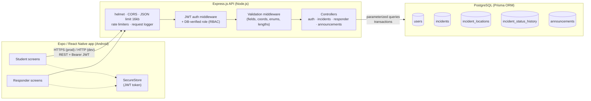
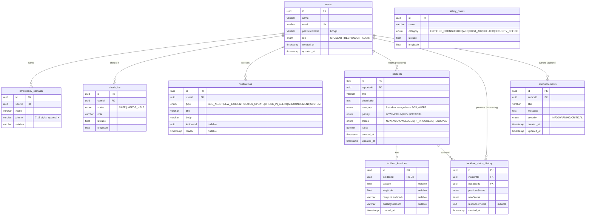
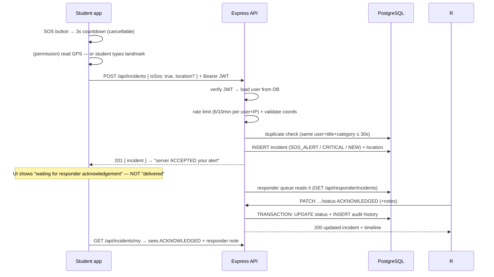
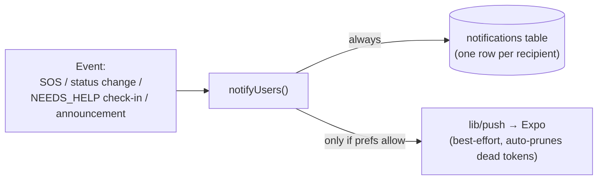

# System Architecture

## 1. High-level layers



Multiple devices talk to the **same** server and database — incident state lives
in PostgreSQL, never only on the phone (spec §3).

## 2. Data model (ERD)



Indexes: `incidents(reporterId, status, priority, category, isSos+createdAt)`,
`incident_status_history(incidentId)`, `announcements(createdAt)`, `users(role)`.
Location rows cascade on incident delete; history rows are kept FK-validated.

## 3. SOS request lifecycle



## 4. Security model (implemented)

| Threat | Mitigation |
|--------|-----------|
| Plaintext passwords / DB leak | bcrypt hashes (cost 10), hashes never returned by any endpoint |
| Token forgery | HS256 JWT, secret ≥ 32 chars enforced at boot, signature+expiry verified per request |
| Privilege escalation ("make me responder") | Role stored server-side only; register hardcodes STUDENT; middleware re-reads the DB user on every request; responder creation gated by `RESPONDER_SETUP_CODE` |
| IDOR (view/modify others' incidents) | Ownership check on `GET /:id`; status changes responder-only; reporterId always taken from the token |
| Brute-force login | Rate limit: 10 failed attempts / 15 min / IP; identical error for unknown email vs wrong password |
| Spam / duplicate SOS | 6 submissions / 10 min / user+IP + 30-second duplicate window (409) |
| Injection | Prisma parameterized queries only |
| XSS / sniffing | helmet secure headers; CORS restricted via env; 16 KB body cap; no client-supplied HTML rendered |
| Secret leakage | `.env` git-ignored, `.env.example` placeholders only; stack traces logged server-side, generic `INTERNAL_ERROR` to clients |
| Location over-collection | GPS requested only inside SOS/report flows; denied → landmark fallback; locations stored per-incident only |

### Honest limitations (prototype — documented, not hidden)

- **No real emergency-services integration.** Alerts reach only demo responder accounts on this server.
- **Delivery vs acknowledgement:** the app proves *server acceptance* (201) and later shows *responder acknowledgement* from the audit trail. It does not claim push delivery to responders (no push notifications yet — planned).
- **HTTPS:** enforced in deployment docs (reverse proxy / cloud TLS); local development uses plain HTTP.
- JWTs are not refresh-rotated; logout is client-side token deletion (stateless JWT trade-off).
- Rate limits are per-instance (in-memory); a multi-node deployment would use a shared store.

## 5. Repository layout

```
campusshield/
├── mobile/                 Expo app (Expo Router, JavaScript)
│   ├── app/                10+ screens (file-based routing)
│   ├── assets/             app icon, adaptive icon, splash, favicon
│   └── src/                api client (silent refresh), AuthContext (SecureStore),
│   │                       components, hooks, utils/pushRegister (Expo push)
├── backend/
│   ├── prisma/             schema.prisma, migrations/, seed.js
│   ├── src/
│   │   ├── config/         env loading + validation (fail-fast)
│   │   ├── middleware/     auth (JWT+RBAC), validation, rate limiters, errors
│   │   ├── controllers/    business logic per domain
│   │   ├── routes/         /api route tables
│   │   ├── lib/            prisma client, push (Expo push via plain fetch)
│   │   └── utils/          jwt, password, constants, pagination, errors
│   └── tests/              51 Jest + Supertest tests
├── docs/                   SETUP · API · TESTING · ARCHITECTURE · screenshots/
├── postman/                ready-to-import collection with auto-token scripts
├── README.md
└── .gitignore
```

## 5b. Session security model (v2)

```
login ──► accessToken (JWT, short-lived)          ──► every API call
      └► refreshToken (random 96-hex)             ──► POST /api/auth/refresh
          · stored hashed (SHA-256) in DB
          · rotation: refresh revokes the old row, issues a new pair
          · replay of a rotated token → 401 (limits a leak window)
          · password change revokes ALL of a user's refresh tokens
          · logout revokes the presented token (idempotent)
          · 5 consecutive failed logins → account locked 15 min (423)
```

The mobile app stores both tokens in Expo SecureStore and transparently
refreshes on `401 TOKEN_EXPIRED`, then replays the failed request once —
sessions survive expiry without a login screen unless refresh also fails.

## 5c. Push notification flow (v2)

```
mobile (physical device, permission granted)
  └► expo-notifications.getExpoPushTokenAsync()
       └► POST /api/devices/push-token  (upsert by token)

server events (best-effort, never block/fail the request)
  · incident created  ──► push all RESPONDER users
  · status updated    ──► push the reporter
  · announcement      ──► push everyone except the author
       └► lib/push.js: plain fetch to exp.host, 100/chunk,
          DeviceNotRegistered receipts auto-prune dead tokens
```

Honest caveats: push needs a physical device (emulators cannot receive),
Expo Go delivers for SDK 52 but production should use an EAS build with
FCM/APNs credentials, and push is an enhancement — the app fully works
without it (in-app lists remain the source of truth).

## 6. Deployment notes (for after the hackathon)

1. Host PostgreSQL (managed service or self-hosted); set `DATABASE_URL` to it.
2. Build & serve the API behind TLS (`nginx`/Caddy or a PaaS); set `NODE_ENV=production`, a fresh `JWT_SECRET`, `CORS_ORIGIN=https://your-web-origin`, empty `RESPONDER_SETUP_CODE` unless needed.
3. Run `npx prisma migrate deploy` (never `migrate dev` in production).
4. Point the app's production branch of `getApiBaseUrl()` at the HTTPS URL.
5. Rotate the seeded demo credentials away or delete them (`prisma migrate reset` in prod is destructive — avoid).

## 5d. Notification pipeline (v3)

All alerting flows through `src/lib/notify.js` so behaviour is uniform:



- **Rows are always written** — a student who was offline at 2 AM still sees
  the status update in the in-app center when they next open the app. Push
  failure never loses an alert.
- **Preferences gate push only**: `push`, `sosAlerts`, `statusUpdates`,
  `announcements` booleans on the user row (validated `PUT /api/me/preferences`).
- Staff-facing alerts (SOS, NEEDS_HELP, new incidents) fan out to every
  RESPONDER **and ADMIN** account.
- The mobile home screen polls `GET /api/notifications/unread-count` every
  30 s for the bell badge — this works everywhere, including Expo Go, with
  no FCM/APNs credentials (true push needs them and is documented as a
  production step).

## 5e. Photo evidence flow (v3)

1. Mobile picks an image via `expo-image-picker` (read-only gallery
   permission; ≤5 MB checked client-side too).
2. `POST /api/incidents/:id/photo` (multipart) → multer memory storage →
   MIME allow-list (jpeg/png/webp) + 5 MB cap → written by the server as
   `uploads/<uuid>.<ext>` (client never controls the path).
3. `incidents.photoPath` stores the public path; static serving sets
   `Cross-Origin-Resource-Policy: cross-origin` + `X-Content-Type-Options`.
4. Replacing/deleting removes the previous file (best-effort cleanup).
5. Ownership: only the reporter can attach/remove; view access follows the
   incident's own visibility rules (owner or staff).

> Honest limitation: uploads live on the API server's disk and the path is
> public-but-unguessable. Production should move to private object storage
> (S3/GCS) with short-lived signed URLs and antivirus scanning.
